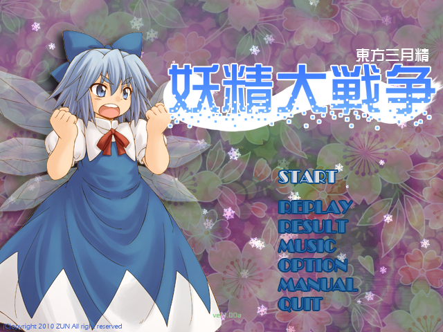

# 妖精大戦争 ～ 東方三月精 ～ Fairy Wars

Agent workflow: follow the highest-priority requirements in [AGENTS.md](AGENTS.md). Use affected exact checks and searchable Markdown knowledge; ordinary notes do not require full CI or replay.

<p align="center">
  
</p>

<p align="center">
  
</p>

This project reconstructs the original Japanese TH12.8 version 1.00a
executable. It starts from an independently versioned, hash-attested target and
tracks boundary, origin, source presence, codegen exactness, native-product
closure, runtime semantics, and portability as separate facts.

## Exact target

Place your own legal copy at the ignored canonical path
`resources/th128.exe`. Repository tools use that path by default. An explicit
path or `TH128_TARGET_PATH` is supported only for deliberate local overrides;
normal reconstruction work uses the canonical path.

| Property | Required value |
| --- | --- |
| Version | original Japanese 1.00a |
| Size | `752,640` bytes |
| SHA-256 | `ba515750ece845b56640fe440592fc39ebb7bdd1ed87c541b67a19b148e767d4` |
| MD5 | `c388671784f6a2aedd97ba9fc648c8c9` |
| Image base | `0x00400000` |
| Entry point | `0x0047460E` |

The pinned [thcrap version database](https://github.com/thpatch/thcrap-tsa/blob/f08b582ce57bce800955dd371fc9a68dbad5b324/base_tsa/versions.js)
classifies this exact SHA-256 as `th128`, `v1.00a`, `(original)` and lists the
English-patched and Steam executables under different digests. The PE
timestamp is 2010-08-03, before the game's August 2010 release.

```bash
scripts/repo-python scripts/verify-target.py
scripts/repo-python scripts/validate-tracking.py --require-target
scripts/repo-python scripts/verify-toolchain.py --execute
```

PE linker 10.0 and Rich build-30319 records identify **Visual C++ 2010 RTM**
(cl `16.00.30319.01`). The Rich header also records 56 LTCG C++ objects, so
game code is compared through a cold `/GL` linked-PE Oracle as well as the
normal-COFF Oracle. The compiler runs headlessly in a TH128-only Wine prefix.

Analysis uses direct local Ghidra through `scripts/ghidra.py`. The runner
verifies disk/Program identity, base/entry, distributed mapped bytes and the
complete mapped `.text` before every query, then reuses the saved project. See
[`AGENTS.md`](AGENTS.md) and [`docs/TOOLS.md`](docs/TOOLS.md).

The title screen above was captured from the original under Xvfb with
`scripts/capture-title-screen.sh`. Original executables, game data, analysis
databases, decompiler output, compiler payloads and downloaded tools are
private and never committed.

## Current status

Current ledger-derived counts and exact bytes are in
[docs/PROGRESS.md](docs/PROGRESS.md). Generate them with
`scripts/repo-python scripts/progress.py`.

[docs/RE_HANDOFF.md](docs/RE_HANDOFF.md) is the single restart guide: current
source work, nonexact frontiers and focused comparison commands.
[docs/KNOWLEDGE_BASE.md](docs/KNOWLEDGE_BASE.md) keeps verified findings,
current blockers and useful failed approaches. The candidate inventory is not
proven complete; the native Windows product is not yet linked or
runtime-validated.

Only rebuild and compare affected complete owners and their dependencies.
Create coherent local checkpoints with the required format
`gpt-web: <English summary>` and preserve existing dirty/untracked work.
`config/build.toml` records open whole-product questions; exact functions do
not establish that graph.

Use `python3 scripts/ci.py` for fast syntax/public-file, ledger, build
declaration and whitespace checks. This is also the GitHub Actions command.
`python3 scripts/ci.py --full` adds the synthetic Oracle suites.

## Required phase order

1. Preserve the reviewed boundary/origin inventory and recover exact VC10
   authored units.
2. Close and exercise the faithful Windows i386 product, including static data
   ownership, initializers, resources, libraries, and runtime scenarios.
3. Perform semantic reconstruction with two independent runtime Oracles: the
   original target and the reconstructed native i386 product.
4. Start a portability branch only after the native semantic baseline is
   trustworthy.

Exact functions do not imply a complete or runnable product. A modern port can
hide missing original data owners, ABI behavior, and initialization, so it is
not an acceptable shortcut around the native-product stage.

## Project map

- [AGENTS.md](AGENTS.md) — session, evidence, retention and checkpoint rules.
- [config/target.toml](config/target.toml) — original target identity.
- [config/tools.lock.toml](config/tools.lock.toml) — pinned compiler, analyzer and decoder identities.
- [config/match-units.toml](config/match-units.toml) — rebuild/comparison recipes.
- [config/matches.csv](config/matches.csv) — canonical exact ledger.
- [config/build.toml](config/build.toml) — whole-product graph and unknowns.
- [docs/RE_HANDOFF.md](docs/RE_HANDOFF.md) — current restart guide and frontiers.
- [docs/KNOWLEDGE_BASE.md](docs/KNOWLEDGE_BASE.md) — useful conclusions and failures.
- [docs/RE_WORKFLOW.md](docs/RE_WORKFLOW.md) and [docs/ORACLES.md](docs/ORACLES.md) — bounded loop and acceptance boundaries.
- [docs/LINKED_ORACLE.md](docs/LINKED_ORACLE.md) — VC10 `/GL` linked-function acceptance.
- [docs/ARCHITECTURE.md](docs/ARCHITECTURE.md) — observed target and source map.
- [docs/TOOLS.md](docs/TOOLS.md) and [docs/SHARED_TOOLS.md](docs/SHARED_TOOLS.md) — compiler/Ghidra/runtime routing.
- [docs/PROGRESS.md](docs/PROGRESS.md) — generated ledger totals.
- [Touhou Reconstruction Factory](https://github.com/N0zoM1z0/touhou-reconstruction-factory) — shared workflow and cross-game knowledge.

## Credits

The Oracle, receipt, LTCG-link and Ghidra tooling is adapted from the
[TH11 reconstruction](https://github.com/N0zoM1z0/th11), and the repository
layout follows the [TH09 reconstruction](https://github.com/N0zoM1z0/th09).

## License

Project code and documentation are under the [MIT license](LICENSE). The
license does not cover the original game or its assets.
