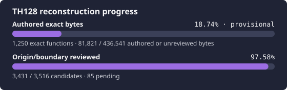

# 妖精大戦争 ～ 東方三月精 (Fairy Wars)

Agent workflow: follow the highest-priority requirements in [AGENTS.md](AGENTS.md). Use affected exact checks and searchable Markdown knowledge; ordinary notes do not require full CI or replay.

<p align="center">
  
</p>

This project reconstructs the original Japanese TH12.8 version 1.00a
executable. It follows the TH09 and TH11 reconstruction workflows: target
identity, reviewed boundaries and origins, maintained source, exact historical
code generation, native product closure and runtime validation are tracked as
separate facts.

## Exact target

Supply your own legal copy at the ignored path `resources/th128.exe`.

| Property | Required value |
| --- | --- |
| Version | original Japanese 1.00a |
| Size | `752,640` bytes |
| SHA-256 | `ba515750ece845b56640fe440592fc39ebb7bdd1ed87c541b67a19b148e767d4` |
| MD5 | `c388671784f6a2aedd97ba9fc648c8c9` |
| Image base | `0x00400000` |
| Entry point | `0x0047460E` |

The pinned [thcrap version database](https://github.com/thpatch/thcrap-tsa/blob/f08b582ce57bce800955dd371fc9a68dbad5b324/base_tsa/versions.js)
identifies this SHA-256 as `th128`, `v1.00a`, `(original)`. Patched, Chinese,
English and Steam executables are different targets.

```bash
scripts/repo-python scripts/verify-target.py
scripts/repo-python scripts/validate-tracking.py --require-target
scripts/repo-python scripts/verify-toolchain.py --execute
scripts/repo-python scripts/ghidra.py check
```

## Toolchain

PE linker 10.0 and Rich build-30319 records identify **Visual C++ 2010 RTM**
(cl `16.00.30319.01`). The Rich header records 56 LTCG C++ objects, so game
code is compared through a cold `/GL` linked-PE Oracle as well as the
normal-COFF Oracle. The compiler runs headlessly under a TH128-only Wine
prefix; Ghidra, JDK and Wine come from the shared Factory runtime. See
[docs/TOOLS.md](docs/TOOLS.md) and [docs/ORACLES.md](docs/ORACLES.md).

Original executables, game data, Ghidra databases, decompiler output, compiler
payloads and build artifacts are private and never committed.

## Status

Generated counts are in [docs/PROGRESS.md](docs/PROGRESS.md). Start
continuation at [docs/RE_HANDOFF.md](docs/RE_HANDOFF.md); verified findings
are in [docs/KNOWLEDGE_BASE.md](docs/KNOWLEDGE_BASE.md).

## Phase order

1. Review boundaries and origins and recover exact VC10 authored units.
2. Close and exercise the faithful Windows i386 product.
3. Semantic reconstruction against two runtime Oracles: the original target
   and the reconstructed native product.
4. Portability, only after the native semantic baseline is established.
